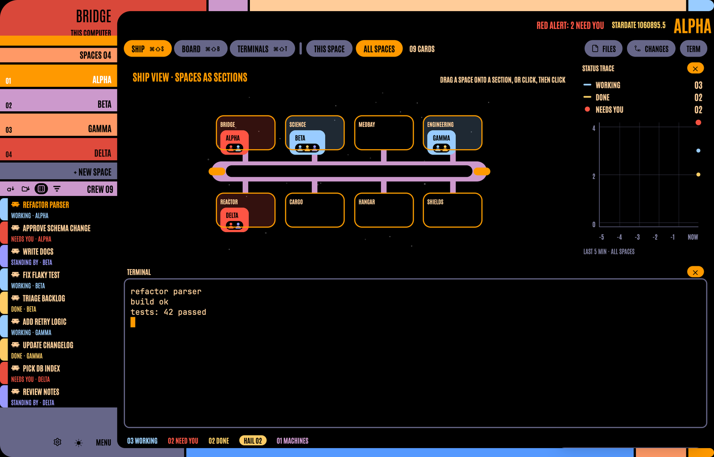

# herdr-layout-lcars

An LCARS-inspired layout for the [Herdr](https://herdr.dev) desktop app: black ground, flat orange / peach / lilac slabs joined by
elbows, condensed all-caps type, and colour that means one thing, agent status.

This is an independent fan project. It is not affiliated with, endorsed by or sponsored by Paramount, CBS or the Star Trek
franchise. "LCARS" is only a style reference for the look; no Star Trek artwork, logos or text is included.


(I didn't use anything looking like any copyrighted materials, like certain saucer-looking ship. but you could make your own...)

## What you get

- Three views, switched from the bar (or `cmd-shift-s` / `cmd-shift-b` / `cmd-shift-t`):
  - **Ship**: your spaces as sections of a drawn space dock. Drag a space chip onto a section. Status trace panel and a terminal below.
  - **Board**: every agent as a card in BLOCKED / WORKING / DONE / IDLE columns, with a quick terminal underneath.
    Pencil or `rename` names a card (stored as the terminal label `lcars.name`).
  - **Terminals**: your tabs and panes, each pane with an LCARS header (back, status, split, zoom, close).
- **Crew** list in the sidebar with harness icons, a filter box (words in any order, also matches terminal id and title) and sort
  buttons (A-Z, by project).
- **Status trace**: stepped lines of WORKING and DONE over the last five minutes, a red mark when someone becomes blocked.
- **Red alert**: the frame turns red and says `RED ALERT: n NEED YOU` while an agent is blocked.
- **Hail badge**: `HAIL nn` in the bottom bar when agents are done; click to jump to the oldest.
- **Reticle** on the selected board card and a short shimmer on new panes.
- **Go to terminal** (`cmd-o`): finder over every terminal; any word matches id, name, title, space, tab, folder or program.
- **Quick terminal** (`TERM` in the bar, `cmd-shift-j` or ``ctrl-` ``): one long-lived shell per folder in a window over the work area.
- **Light and dark** (`cmd-shift-m`, or the sun/moon at the bottom left).
- Files and Changes side panels (`cmd-shift-f`, `cmd-shift-g`).

## Install

Tell your Herdr agent:

> add herdr.dev/layouts/wakaru44/lcars-bridge

or by hand, from a clone of this repo into `~/.config/herdr-app`:

```sh
cp layouts/lcars-bridge.json layouts/lcars-bridge.svg ~/.config/herdr-app/layouts/
cp themes/lcars-bridge-*.json ~/.config/herdr-app/themes/
cp fonts/Antonio-*.ttf fonts/LICENSE-antonio-OFL.txt ~/.config/herdr-app/fonts/
cp -R mods/lcars-* ~/.config/herdr-app/mods/
```

Copy, do not symlink: Herdr does not draw images behind symlinks. Then merge `keys.json` into your own (below), run
`herdr-app check ~/.config/herdr-app/mods/lcars-bar` (and the other mods), and switch with the layout command (`layout.switch lcars-bridge`).
Your own layout stays as it was; `cmd-shift-l` switches back. Install JetBrains Mono for the terminals or change `font` in the layout.

### Keys

`keys.json` holds only what this layout needs and is meant to be **merged** into yours, not to replace it:

| Key | Does |
|---|---|
| `cmd-shift-s` / `b` / `t` | ship / board / terminals view |
| `cmd-shift-f` / `g` | Files / Changes panel |
| `cmd-shift-m` | light / dark |
| `cmd-shift-j`, ``ctrl-` `` | quick terminal |
| `cmd-o` | go to terminal (section `global`) |

## What it runs (read before installing)

Nothing uses the network. See `RECIPE.md`, "Watch out", for the full list. In short:

- `lcars-bar` runs **`python3` to rewrite your `~/.config/herdr-app/settings.json`**: the light/dark switch flips the `appearance`
  key, re-serialising the whole file as JSON (key order kept; comments or hand formatting are lost). It also runs `herdr-app` and
  `hc` (from `PATH`, `~/.local/bin`, `/usr/local/bin`) to start and park the quick terminal.
- `lcars-board` runs `hc label` to store card names on terminals.
- `lcars-files` runs `sh`, `git` (status), `powershell` on Windows, and `open` / `code` from its right-click menu; it reads files of the project you browse.
- `lcars-goto` and `lcars-ship` only read Herdr state.

## Ship art (optional)

The ship view draws a plain space dock by default; no pictures are bundled. To get a generated picture behind your spaces, tell your agent:

> set up the ship art for lcars-bridge following docs/ship-art/AGENT-SETUP.md

It generates candidates from [`docs/ship-art/PROMPTS.md`](docs/ship-art/PROMPTS.md), makes the light variant with `tools/make-light-art.py` and
registers it. By hand: `mods/lcars-ship/art/README.md`.

## Design

[`DESIGN-SYSTEM.md`](DESIGN-SYSTEM.md): palette, geometry, components, accessibility rules and backlog.
`python3 -I tools/check-contrast.py` checks the palette. Unit tests: `node mods/lcars-wave/wave.test.mjs`,
`node mods/lcars-goto/rank.test.mjs`.

## Credits

- The frame (elbows, sidebar, status arm), the palette and the idea come from the `lcars` layout in
  [jkuepker/herdr-layouts](https://github.com/jkuepker/herdr-layouts) (MIT, Josef Kuepker). See `THIRD-PARTY.md`.
- [Antonio](https://github.com/googlefonts/antonio) font, SIL OFL 1.1.
- Agent icons from Herdr / LobeHub icons (MIT); trademarks belong to their owners.

## Licence

MIT, see `LICENSE`. Third-party notices in `THIRD-PARTY.md`.
