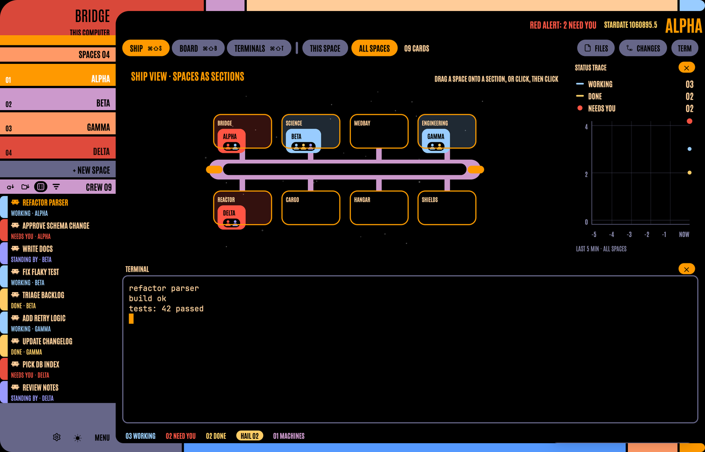

# LCARS Bridge

A black Herdr window framed in LCARS-style slabs: an orange elbow top left carrying the BRIDGE wordmark, a coloured sidebar of
spaces and crew, a pill bar of tabs and view buttons, and a bottom bar with counts and a clock. The middle shows one of three
views (ship, board, terminals). Colour is chrome (orange, peach, lilac, tan) except four status colours. Light and dark both exist.



## What you see

Dark palette on `#000000`; light palette on Solarized-light paper `#fdf6e3`. UI font Antonio (bold, ALL CAPS chrome), terminal font
JetBrains Mono. Flat fills, 4px black gaps, black ink on slabs. Status colours: working `#99ccff`, blocked `#ff5544`, done `#ffcc66`,
idle `#9999ff`; chrome orange `#ff9900`, peach `#ff9966`, tan `#ffcc99`, lilac `#cc99cc`, grey `#666688`.

Top to bottom, left to right:

- **Top bar, 64px** (draggable window area). Upper-left elbow 210px wide, orange (red `#d9483a` while anyone is blocked), outer radius 44, the
  word BRIDGE (Antonio 26) upper right and the machine name below it. To its right a thin arm of coloured segments, the title line
  (space name; `RED ALERT: n NEED YOU` in red when blocked agents exist; `STARDATE yyyy.fff`, an invented 7-digit date).
- **Sidebar, 210px fixed.** SPACES: one 40px slab per space (the selected one orange with white text, a blocked one red, others cycle
  peach / lilac / violet / tan), `+ NEW SPACE`. CREW: a lilac label row with a filter button and sort buttons, then one row per agent
  (harness icon, name, status word). Rows are tinted by status.
- **Bar, 30px**, at the top of the work area: view pills `SHIP | BOARD | TERMINALS` (lit = orange, else grey, violet on hover), a
  separator, one pill per tab of the selected space, `FILES` / `CHANGES` toggles, `TERM`, window buttons where the OS
  draws none. In board view it also shows `THIS SPACE | ALL SPACES` and a card count.
- **Work area**, padding 8/12, gap 8, one of:
  - **Ship**: top row (weight 11) with the ship stage (left) and the STATUS TRACE panel (230px, right); below (weight 9) a foldable
    terminal. The stage is a drawn space dock: a lilac spine with eight bays (BRIDGE, SCIENCE, MEDBAY, ENGINEERING, REACTOR, CARGO,
    HANGAR, SHIELDS), a starfield, and a tray of UNASSIGNED space chips.
  - **Board**: four status columns (BLOCKED, WORKING, DONE, IDLE) of black cards, a foldable terminal below (weight 9).
  - **Terminals**: the active tab's panes, 2px rounded (10) frames, a 30px header on every pane.
- **Side panel**, 280px (min 240, max 900), hidden until FILES or CHANGES is toggled.
- **Bottom bar, 44px**: lower-left elbow (grey, radius 40) with MENU, a gear and a sun/moon; then counts per status, `HAIL nn`
  (gold pill, only when agents are done), the clock.

## How it behaves

Agent statuses:

- **working**: blue strip and word `WORKING`; shown in the WORKING board column; plotted as a blue trace.
- **blocked**: red; word `NEEDS YOU`; the top elbow turns `#d9483a`, the title line shows `RED ALERT: n NEED YOU`, the crew row, tab pill
  and space slab pulse for ~5 s when the count rises (opacity 0.4-1, 700-900 ms), then hold.
- **done**: gold; `DONE`; the bottom bar shows `HAIL nn` (pulses when it grows); click it to jump to the oldest done agent.
- **idle**: violet; `STANDING BY`; board title and chrome dimmed to grey.

Interactions:

- Bar view pills and keys `cmd-shift-s/b/t` switch the layout stack `view` (`ship`, `board`, `terminals`); `cmd-shift-f/g` show or hide the
  side column and select `files` or `changes`; `cmd-shift-m` flips light/dark; `cmd-shift-j` or ``ctrl-` `` shows/hides the quick terminal.
- Tab pills: click selects, double-click renames, drag reorders, right-click opens Herdr's own menu, an X on the active one closes it,
  `‹ n` / `n ›` step when there are more than 6 tabs (4 while the side panel is open).
- Sidebar: click a space selects it; right-click opens Herdr's menu. Crew filter: words in any order, matching name, title, project,
  terminal id; kept across restarts, with a clear button. Sort buttons cycle off, ascending, descending (A-Z; by project).
  `agent.next` / `agent.prev` follow the filtered, sorted order.
- Board: shows the selected space's agents; `ALL SPACES` shows all. Click a card shows that agent in the terminal under the board;
  double-click or Enter opens its tab. The selected card gets an orange border, a breathing corner reticle, and a short shimmer on new
  panes. The pencil (or `rename` in the card's menu) stores a name as terminal label `lcars.name`, which beats the agent's title.
- Ship: drag a space chip (or click it, then click a section) onto a bay; the bay tint is the worst status of its spaces. Dropping on the
  tray unassigns. Crew icons on chips: star for a tab whose name starts with "foreman", person for claude, diamond for codex, dot for others;
  clicking a star or a done icon focuses that agent. An optional `ART:` pill row shows only when custom art is configured.
- Panes: header `← BOARD`, status dot, title, status word, short id, split right, split down, zoom, close; the rule under it is orange when
  focused, else status coloured.
- `cmd-o` opens a popup finder (760px wide, 80% tall, near the top): type words (OR across id, name, title, space, tab, folder,
  program), arrows and Enter jump to that terminal, Esc closes.
- STATUS TRACE and TERMINAL headers have a pill that hides the block (X) and brings it back (SHOW).

## Built from

Layout `layouts/lcars-bridge.json` (`id: root`), themes `lcars-bridge-dark` / `lcars-bridge-light` (`theme: {light, dark}`), `ui_font: Antonio`,
`font: JetBrains Mono`, `titlebar: none`, `traffic_lights: [226, 34]`, preview `layouts/lcars-bridge.svg`. Node tree:

```
root column
  top block 64px window_drag       lcars-frame {part: top}
  body row
    sidebar block 210px (min/max 210) lcars-frame {part: side}
    work column padding [8,12] gap 8 resizable:false
      bar block 30px window_drag   lcars-bar
      view stack (active: terminals)
        ship column gap 8
          ship-top row gap 8 weight 11 min 160: ship-surface (lcars-ship), ship-wavebox column 230px min 180
              [ship-wavehead lcars-termhead {target: ship-wave, label: STATUS TRACE, box: ship-wavebox, restore: {px:230}, collapsed: 76}, ship-wave lcars-wave]
          ship-termbox column weight 9: ship-termhead (lcars-termhead, target ship-term, label TERMINAL, restore {weight 9}),
              ship-term block {agent: focused}, radius 10, border 2 border/accent on focus
        board column gap 8: board-cards (lcars-board) weight 11 min 160, board-termbox (same shape as ship-termbox)
        terminals block {tab: active, pane: gap 8, radius 10, lone, border 2, focus accent, header mod lcars-pane 30px top always}
    side column hidden 280px min 240 max 900 padding [8,12]
      side-body stack (active files): files (lcars-files), changes (Herdr's shipped `changes` mod)
  bottom block 44px                lcars-frame {part: bottom}
```

Mods (all `place: none`; palettes read `settings().dark` on every render):

- `lcars-frame`: one mod, three parts plus a popup part `machines`. Reads spaces, agents, panes, machines; runs `space.*`, `agent.focus`, `app.settings`; `setAgentOrder`;
  shared keys `lcars.crew.sort`, `lcars.crew.filter`, `lcars.crew.filter.open`. Icons in `icons/`.
- `lcars-bar`: tabs, view pills, panel toggles, window buttons, quick terminal. Commands `view:<ship|board|terminals>`, `panel:<files|changes>`, `appearance`, `term`
  (from keys.json). Uses `layout.select {stack:"view"}`, `layout.show/hide {id:"side"}`, `tab.*`, `window.*`, `agent.focus`. Shared `lcars.view`, `lcars.panel`,
  `lcars.board.scope`, `lcars.term.{map,addr,open,pinned}`.
- `lcars-board`: cards and columns; popup `menu` and a rename dialog via `openOverlay`. Terminal label `lcars.name`. Shared `lcars.view`, `lcars.board.scope`, `lcars.board.termShown`.
- `lcars-pane`: pane header; `pane.split/zoom/close` with an explicit pane; shared `lcars.view`.
- `lcars-ship`: shared `lcars.ship.assign` ({spaceId: zoneId}), `lcars.ship.art`. `art/` optional.
- `lcars-wave` (+ `wave.js`, tested by `wave.test.mjs`): samples all agents every 2 s while mounted, keeps 150 samples.
- `lcars-termhead`: folds the node named by `target` through `layout.*`.
- `lcars-term`: header of the quick-terminal window (opened by `lcars-bar`, not placed in the layout).
- `lcars-goto` (+ `rank.js`, `rank.test.mjs`): popup overlay `{kind: popup, at: top, offset: 40, width: 760, height: 0.8}`.
- `lcars-files`: Herdr's file browser restyled, with a right-click menu (`open`, `code`).
- Shipped mods used: `changes`.

Programs run: see Watch out. Art: none required; the only pictures are SVG glyphs in the mods and the layout's `preview` svg.
Keys: `keys.json` (`layout:lcars-bridge` section and `global` `cmd-o`: `mod.open:lcars-goto`).

## Watch out

- **`lcars-bar` rewrites your `settings.json`.** The light/dark switch runs `python3 -c` that loads `~/.config/herdr-app/settings.json`, flips
  `appearance` between `light` and `dark`, writes the whole file back as JSON (indent 2, key order kept; comments and hand formatting lost) and
  touches it so Herdr reloads it. It needs `python3` on `PATH`.
- Programs run: `lcars-bar`: `python3`, `herdr-app do terminal.open` / `terminal.park`, `hc get <terminal>` (via `sh -c`, `PATH` extended with
  `$HOME/.local/bin:/usr/local/bin`); `lcars-board`: `hc label <terminal> lcars.name=<name>`; `lcars-files`: `sh`, `git rev-parse` / `git status`, `powershell` on Windows,
  `open`, `code`; and it reads files in the shown project (`readTextFile`, `watchFolder`). `lcars-goto` and `lcars-ship` read Herdr state only.
  No mod uses the network (no `fetch`, sockets or URLs).
- Copy images, never symlink them; Herdr does not draw an image behind a symlink.
- Edits to a symlinked file do not reload until the link is touched (`touch -h`).
- Mods may only import files inside their own folder, so each mod keeps its own copy of the palette. Keep them in step with `tools/check-contrast.py`.
- The `changes` mod and the Files side column assume Herdr's shipped `changes`; if missing the panel is empty.
- The terminal blocks use `{ agent: focused }`; when the board hides every pane Herdr falls back to the first agent and may jump spaces. `lcars-bar` pins an
  agent of the selected space before switching views to avoid it.
- Herdr has no command to focus an overlay's terminal: click inside the quick terminal to type.
- The quick terminal window does not survive a reload or restart; it starts closed.
- Wave history lives only while the panel is mounted; it is lost on reload.
- Ship art is optional and user-supplied: the repo ships no pictures; the default is the drawn dock (`docs/ship-art/AGENT-SETUP.md`).
- The ship view's section names are labels only; saved assignments are keyed by zone id.
- Sizes: crew shows 14 rows at 820px height before clipping; tab pills show 6 at a time (4 with the side panel open).
- Pulses stop after 5 s; the pulse opacity floor is 0.4 (documented gap in `DESIGN-SYSTEM.md`).

## Done when

- `herdr-app check` passes for every `mods/lcars-*` folder and `layout.switch lcars-bridge` shows the frame without error toasts.
- The top elbow is 210px wide and orange; the sidebar is 210px; bar 30px; bottom bar 44px.
- `cmd-shift-s`, `cmd-shift-b`, `cmd-shift-t` switch views; the board shows one card per agent of the selected space and `ALL SPACES` shows all.
- A blocked agent turns the top elbow red and prints `RED ALERT: 1 NEED YOU`; a done agent shows `HAIL 01` in the bottom bar and clicking it focuses that agent.
- `cmd-shift-m` flips the theme and changes `appearance` in `settings.json`; both themes are legible.
- Dragging a space chip onto a bay in the ship view tints the bay by status; reloading keeps the assignment.
- `cmd-o` lists every terminal and Enter jumps to the chosen one; typing two words from different fields still matches (OR).
- `node mods/lcars-wave/wave.test.mjs` and `node mods/lcars-goto/rank.test.mjs` print `ok`.
